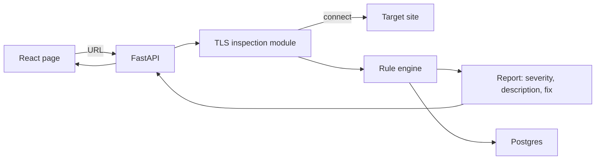
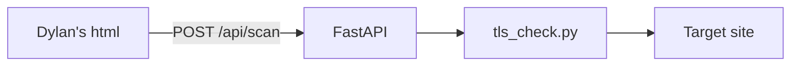

# Architecture

Source: proposal doc, Technical feasibility section.

React + TypeScript frontend, Python FastAPI backend, PostgreSQL.

## What exists today

- app/main.py: routes
- app/tls_check.py: opens a TLS connection, reads the cert
- static/index.html: Dylan's page, sample data only, not wired to the API yet
- Render deploys main after tests pass
